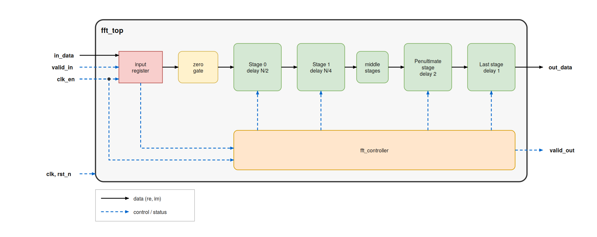
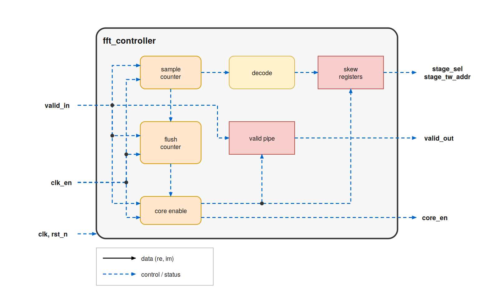
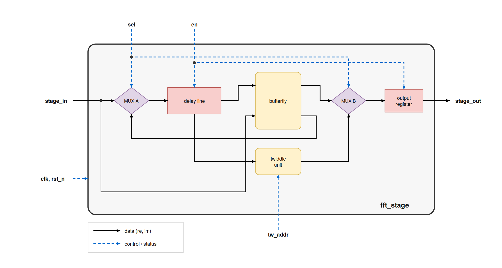
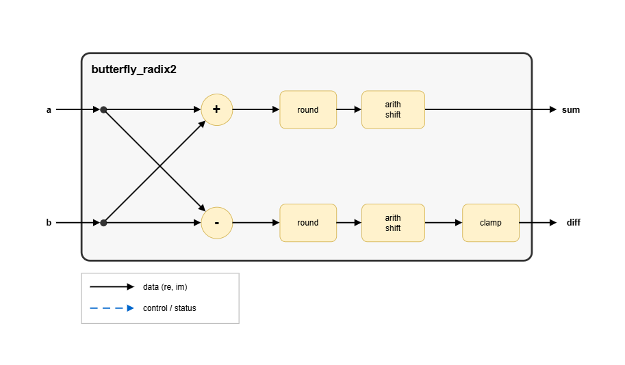

# R2SDF Radix-2 DIF FFT - Design Document

## 0. Overview

### 0.1 Design summary

The core computes an N-point complex FFT on a continuous stream: **one complex sample in per clock, one complex frequency bin out per clock**, with no gaps inside a frame. It is a pipeline of `log2(N)` identical stages. Each stage holds a delay line that stores half of its current window and feeds the butterfly difference back into itself (hence "single-path delay feedback"), so the whole FFT needs only `N-1` complex delay registers.

| Property | Value |
|---|---|
| Algorithm | Radix-2 DIF, single-path delay feedback (R2SDF) |
| Points | `N`, any power of 2 (the twiddle ROM must be generated for the same `N`, see section 1.7) |
| Number format | 16-bit signed Q1.15 per component (`complex_t = {re, im}`) |
| Scaling | Divide by 2 in every butterfly, so the total is 1/N and there is **no bit growth**. Output = `DFT(x) / N` |
| Throughput | 1 complex sample per clock, 100 percent duty cycle |
| Output order | **Bit-reversed** bins. `fft_reorder_buffer` can convert them to natural order |
| First-output latency | `(N-1) + log2(N) + (log2(N)-2)*MULT_PIPE_STAGES + 1` clocks after the first input sample |
| Butterflies | `log2(N)` (one per stage) |
| Complex multipliers | `log2(N) - 2` (the last two stages need only trivial twiddles) |
| Delay storage | `N-1` complex words (`N/2 + N/4 + ... + 1`) |
| Implementation target | `` `define TARGET_FPGA `` selects inferred DSP48 multipliers and carry-chain adders. Not defined selects the ASIC path: Booth radix-4 multipliers and Brent-Kung adders |
| Pipelining | Registered input, registered stage outputs, optional multiplier pipelining (`MULT_PIPE_STAGES`) |
| Reset and enable | Asynchronous active-low `rst_n`, global clock enable `clk_en` |

### 0.2 Top-level interface (`fft_top`)



**Parameters**

| Parameter | Default | Description |
|---|---|---|
| `N` | 32 | FFT size. Power of 2, `N >= 4`. Must match the `N` used to generate `twiddle_rom.sv` |
| `MULT_PIPE_STAGES` | 0 | Internal pipeline registers inside each complex multiplier. Adds `(log2(N)-2)*MULT_PIPE_STAGES` clocks of latency. With the ASIC (Booth) multiplier use 0, 1 or 2 |

**Ports**

| Port | Dir | Width | Description |
|---|---|---|---|
| `clk` | in | 1 | Clock, rising edge |
| `rst_n` | in | 1 | Asynchronous active-low reset. Clears data registers, counters and the valid pipeline |
| `clk_en` | in | 1 | Global clock enable. When low, the input register, the counters and the whole core hold their state |
| `valid_in` | in | 1 | Qualifies `in_data_*`. Hold high for `N` consecutive enabled clocks to present one frame |
| `in_data_re` | in | signed 16 (Q1.15) | Real part of input sample `x[n]` |
| `in_data_im` | in | signed 16 (Q1.15) | Imaginary part of input sample `x[n]` |
| `valid_out` | out | 1 | High for `N` consecutive clocks while the output frame is on `out_data_*` |
| `out_data_re` | out | signed 16 (Q1.15) | Real part of an output bin. Meaningful only while `valid_out = 1` |
| `out_data_im` | out | signed 16 (Q1.15) | Imaginary part of an output bin. Meaningful only while `valid_out = 1` |

**Frame protocol**

- Present `x[0] ... x[N-1]` in natural order on consecutive clocks with `valid_in = 1`.
- After the last sample the core keeps itself running internally for `PIPELINE_LAT` clocks (the *flush*) while the stored differences drain out. You do not drive anything during this time.
- `valid_out` rises `(N-1) + log2(N) + 1` clocks after the first input sample (for `MULT_PIPE_STAGES = 0`) and stays high for `N` clocks.
- Bins appear **bit-reversed**. For N = 8 the order is `X[0], X[4], X[2], X[6], X[1], X[5], X[3], X[7]`.
- Output values are `X[k] = (1/N) * sum over n of x[n] * e^(-j*2*pi*n*k/N)`.
- `clk_en` low freezes everything, including the valid pipeline, so the frame simply resumes when `clk_en` returns.

### 0.3 How the R2SDF computes a DIF FFT

For a window of `2D` samples entering a stage, radix-2 DIF needs:

- `sum[n]  = (x[n] + x[n+D]) / 2`, passed on with no twiddle.
- `diff[n] = (x[n] - x[n+D]) / 2`, multiplied by the twiddle `W^n` before being passed on.

`x[n]` arrives `D` clocks before `x[n+D]`, so the stage must remember the first half. Each stage alternates between two phases of `D` clocks each, selected by `sel`:

| `sel` | Phase | What the stage does |
|---|---|---|
| 0 | **Load / flush** | New samples go into the delay line (MUX A takes `stage_in`). The stage output is the previous window's stored differences, each multiplied by its twiddle (MUX B takes `tw_out`) |
| 1 | **Butterfly** | Incoming sample `x[n+D]` (B) meets `x[n]` (A) coming out of the delay line. The sum goes straight to the output (MUX B takes `bf_sum`). The difference is written back into the delay line (MUX A takes `bf_diff`) |

The next stage therefore sees a stream of half-size windows: `D` sums followed by `D` twiddled differences. The same structure repeats with depth `D/2`, `D/4`, ... down to `D = 1`.

---

## 1. Modules

### 1.1 `fft_pkg` - types and constants

| Item | Definition |
|---|---|
| `DATA_WIDTH` | 16 |
| `complex_t` | packed struct `{ signed [15:0] re; signed [15:0] im; }` (Q1.15 each) |
| `MAX_POS`, `MIN_NEG` | `16'sh7FFF` (+32767) and `16'sh8000` (-32768): saturation limits |
| `TARGET_FPGA` | `1'b1` if `` `TARGET_FPGA `` is defined at compile time, else `1'b0`. Selects DSP and carry-chain inference versus Booth and Brent-Kung hardware in `butterfly_radix2` and `complex_multiplier` |

### 1.2 `fft_top` - integration

See the diagram in section 0.2.

**Function.** Registers the input, instantiates the controller and the `log2(N)` stages, and exposes the last stage output as the result.

- **Input register.** On `clk_en`, `valid_in_FF` follows `valid_in`. `in_FF` captures `in_data` when `valid_in = 1`, and is cleared when `valid_in = 0` while the core is enabled (`core_en`).
- **Zero gate.** `stage_data[0] = valid_in_FF ? in_FF : 0`, so stage 0 sees exact zeros whenever no valid sample is present (important during the flush).
- **Stage chain.** For stage `s = 0 ... log2(N)-1`:

| Stage | `DELAY_DEPTH` | Twiddle unit |
|---|---|---|
| `s < log2N - 2` | `N / 2^(s+1)` | full multiplier (`HAS_MULT = 1`) |
| `s = log2N - 2` | 2 | W4 swap and negate (`IS_W4_STAGE = 1`) |
| `s = log2N - 1` | 1 | none, a wire |

- **Interconnect.** `stage_data[s]` goes into stage `s`, which drives `stage_data[s+1]`. All stages share `core_en` and each receives its own `sel` and `tw_addr` from the controller.
- **Output.** `out_data = stage_data[log2N]`, the registered output of the last stage.

### 1.3 `fft_controller` - timing and synchronization



**Function.** Generates the global enable, the per-stage phase (`sel`) and twiddle address (`tw_addr`), the flush sequence, and `valid_out`.

**Ports:** `clk`, `rst_n`, `clk_en`, `valid_in` (driven by `valid_in_FF`), outputs `stage_sel`, `stage_tw_addr`, `core_en`, `valid_out`.

**Sample counter and flush**

- `cnt` (`log2N` bits) increments with every `valid_in` (on `clk_en`), so it equals the index of the sample currently in `in_FF`.
- When `cnt == N-1` is accepted, `flush_cnt` loads `PIPELINE_LAT = (N-1) + log2N + TOTAL_MULT_LAT`, where `TOTAL_MULT_LAT = (log2N-2)*MULT_PIPE_STAGES`.
- While `flush_cnt != 0` (`flushing`), `cnt` keeps counting and the core stays enabled although there is no new input, so the stored differences are pushed out. When `flush_cnt == 1`, both counters clear.
- `core_en = clk_en && (valid_in || flushing)`: a **gated clock enable** for delay lines, stage output registers, multiplier pipelines, skew registers and the valid pipe.

**Raw (unskewed) control decode**

| Signal | Expression | Meaning |
|---|---|---|
| `raw_stage_sel[s]` | `cnt[log2N-1-s]` | Toggles every `D_s` counts (period `2*D_s`) |
| `raw_tw_addr[s]`, `s < log2N-2` | `cnt[log2N-2-s : 0]` shifted left by `s` | Twiddle index `k*2^s` into the `W_N^k` table |
| `raw_tw_addr[s]`, `s = log2N-2` | `cnt[0]` | W4 select: 0 means times 1, 1 means times (-j) |
| `raw_tw_addr[s]`, `s = log2N-1` | 0 | unused |

**Skew.** Stage `s` sees its data `SKEW_CYCLES = s + MULT_BEFORE*MULT_PIPE_STAGES` clocks after stage 0 (one output register per stage, plus multiplier pipelining in earlier stages). `sel` and `tw_addr` are delayed by exactly that many clocks with enable-gated shift registers, so every stage sees control aligned with its own data.

**Valid pipe.** `valid_pipe` is a `PIPELINE_LAT`-deep shift register of `valid_in`, enabled by `core_en`. `valid_out` is its last bit.

### 1.4 `fft_stage` - one R2SDF stage



**Function.** One radix-2 DIF stage with delay feedback. Parameters: `N`, `DELAY_DEPTH`, `TW_ADDR_WIDTH`, `HAS_MULTIPLIER`, `IS_W4_STAGE`, `MULT_PIPE_STAGES`. Ports: `clk`, `rst_n`, `en` (= `core_en`), `sel`, `tw_addr`, `stage_in`, `stage_out`.

**Blocks**

1. **MUX A** (`sel`): 0 selects `stage_in` into the delay line, 1 selects `bf_diff` (feedback).
2. **Delay line** (`delay_feedback_line`, depth `D`).
3. **Butterfly** (`butterfly_radix2`): A = `delay_out`, B = `stage_in`.
4. **Twiddle unit** works on `delay_out` (the stored difference). One of three variants:

| Variant | Used when | Hardware |
|---|---|---|
| `gen_full_mult` | `HAS_MULTIPLIER = 1` | `twiddle_rom` plus `complex_multiplier` |
| `gen_w4_stage` | `IS_W4_STAGE = 1` (`D = 2`) | Only `W4^0 = 1` and `W4^1 = -j`. `tw_addr[0] = 0` passes the value. `tw_addr[0] = 1` gives `(re, im) -> (im, -re)` with a saturating negate |
| `gen_wire_stage` | last stage (`D = 1`) | `W2^0 = 1`, so `tw_out = delay_out`, no logic |

5. **Multiplier latency alignment** (only if `HAS_MULTIPLIER` and `MULT_PIPE_STAGES > 0`): `bf_sum` and `sel` are delayed `MULT_PIPE_STAGES` clocks to line up with the pipelined `tw_out`.
6. **MUX B and output register:** `sel_b_aligned = 1` selects `bf_sum`, 0 selects `tw_out`. The result is registered into `stage_out` when `en` is high.

| `sel` | MUX A feeds the delay line with | `stage_out` (next) |
|---|---|---|
| 0 | `stage_in` | `tw_out` = `delay_out` times W |
| 1 | `bf_diff` | `bf_sum` |

### 1.5 `delay_feedback_line` - storage

A `DEPTH`-word complex shift register. When `en = 1`, `din` enters entry 0 and every entry moves one step. `dout` is the last entry, so **a word written at clock *t* appears at `dout` at clock *t + DEPTH***. `DEPTH = 1` is a single register. Reset clears all entries. With `en = 0` the contents freeze.

### 1.6 `butterfly_radix2` - sum and difference



**Function.** Takes `a` (from the delay line) and `b` (the incoming sample), and produces `sum` and `diff`, each already divided by 2. All of it is combinational and runs on the real and imaginary parts in parallel.

| Step | Block in the diagram | What it does |
|---|---|---|
| 1 | `adder`, `subtractor` | `a + b` and `a - b` in 18 bits (inputs sign-extended by 2 bits, so no overflow) |
| 2 | `round` | adds 1 (round half up) |
| 3 | `arith shift` | arithmetic shift right by 1, which divides by 2 and brings the value back to 16 bits |
| 4 | `clamp` (diff only) | limits the result to +32767 only when `a - b + 1` equals 65536 |

- The `sum` can never leave 16 bits, so it has no clamp.
- **ASIC:** four 18-bit `adder_subtractor_bk` instances (real and imaginary, add and subtract). **FPGA (`TARGET_FPGA`):** plain `+` and `-`, inferred onto carry chains.

**Why the shift and why the +1.** The shift is for *scaling*: it keeps the word at 16 bits and gives the 1/N total scaling. The `+1` is for *rounding*: without it the shift would truncate (floor). Because the dropped bit can only be 0 or exactly half an LSB, rounding half up just changes the mean error from -0.25 LSB to +0.25 LSB with the same noise power. The `+1` and the diff clamp can be removed to save four incrementers and the clamp logic at the cost of a small constant bias. The RTL currently keeps both.

### 1.7 `twiddle_rom` - twiddle factor table (generated)

**This file is produced by `generate_twiddles.py` for one specific `N`. Regenerate it whenever `N` changes.**

```bash
python3 generate_twiddles.py -N 8 --sv-out twiddle_rom.sv     # N = 8 example
```

The `twiddle_rom.sv` supplied with this project was generated for N = 32 (16 entries, 4-bit address).

| Item | Value |
|---|---|
| Entries | `N/2` (`k = 0 ... N/2-1`) storing `W_N^k = cos(2*pi*k/N) - j*sin(2*pi*k/N)` in Q1.15 |
| `ADDR_WIDTH` | `ceil(log2(N/2))`, matching `TW_ADDR_WIDTH` in `fft_top` |
| `is_unity` | `addr == 0` (W^0 = 1) |
| `is_neg_j` | `addr == N/4` (`W_N^(N/4) = -j`) |
| Exact entries | `k = 0` is `7FFF + j0000`, `k = N/4` is `0000 - j8000` |

It is a combinational `case` lookup, which suits both logic synthesis and FPGA distributed or block ROM. Stage `s` addresses the table with `tw_addr = k*2^s`, which selects `W_N^(k*2^s) = W_(N/2^s)^k`, the twiddle that stage needs. The two flags let `complex_multiplier` skip the multiplication for the trivial cases.

### 1.8 `complex_multiplier` - Y = X times W

Computes `X * W` in Q1.15:

```
Y_re = (X_re*W_re - X_im*W_im + 2^14) >>> 15
Y_im = (X_re*W_im + X_im*W_re + 2^14) >>> 15
```

- **Four real 16x16 multiplies** (`m1 = Xr*Wr`, `m2 = Xi*Wi`, `m3 = Xr*Wi`, `m4 = Xi*Wr`), then `prod_r = m1 - m2` and `prod_i = m3 + m4` in 33 bits.
- **Rounding and saturation:** add `2^14`, take bits `[30:15]`, and saturate to `MAX_POS` or `MIN_NEG` if the 33-bit value does not fit in Q1.15. Unlike the butterfly, this rounding matters: the dropped part is a real fraction spread over the whole range.
- **Bypasses:** `is_unity` gives `Y = X`, and `is_neg_j` gives `Y = (X_im, -X_re)` with a saturating negate.
- **ASIC:** four `booth_radix4_multiplier` (`PIPELINE_STAGES = MULT_PIPE_STAGES`) plus two 33-bit `adder_subtractor_bk`. **FPGA:** `*` with `use_dsp = "yes"`, and when `MULT_PIPE_STAGES > 0` the four products are registered that many times.
- **Latency alignment:** with `MULT_PIPE_STAGES > 0`, `x` and the two bypass flags are delayed by the same amount so the bypass selection stays aligned with the multiplier result.
- All registers are gated by `en`.

### 1.9 `booth_radix4_multiplier` - ASIC 16x16 signed multiplier

1. **Radix-4 Booth encoding** of `b`: 8 partial products instead of 16 (multiples `0, +/-a, +/-2a`), sign-extended and shifted by `2i`.
2. **Two-level 4:2 compressor tree** (`compressor4_2`, `compressor4_2_array`): level 1 reduces 8 rows to 4, level 2 reduces 4 rows to 2 (sum and carry vectors).
3. **Final carry-propagate add** with `adder_subtractor_bk` (32 bit).

Pipelining (`PIPELINE_STAGES`): 0 is combinational, 1 registers after level 2, 2 registers after level 1 and level 2. Registers are gated by `en`.

*Note:* values above 2 still give only 2 register stages, so `MULT_PIPE_STAGES` must stay at 2 or less on the ASIC path, or the controller's latency bookkeeping will not match the multiplier.

### 1.10 `adder_subtractor_bk` - Brent-Kung adder and subtractor

Parameterized parallel-prefix adder. `sub = 0` computes `A + B`, `sub = 1` computes `A - B` (as `A + ~B + 1` with a carry-in at bit 0).

- Generate and propagate pre-processing, a Brent-Kung up-tree and down-tree, then sum = propagate XOR carry.
- Bounded fan-out and low wiring congestion, which suits ASIC place and route.
- Also outputs `cout` and a signed `overflow` flag (unused by the FFT, which widens its operands instead).
- Purely combinational. Used in `butterfly_radix2` (18 bit), `complex_multiplier` (33 bit) and `booth_radix4_multiplier` (32 bit).

### 1.11 `fft_reorder_buffer` - bit-reversed to natural order

A separate block (it is **not** instantiated inside `fft_top`). It sits behind the FFT core, takes the bit-reversed stream and outputs bins in natural order `0, 1, ..., N-1` with full streaming throughput, using a **ping-pong pair of memories**.

| Port | Dir | Description |
|---|---|---|
| `clk`, `rst_n`, `clk_en` | in | clock, async active-low reset, clock enable |
| `valid_in`, `data_in` | in | stream from the FFT core (`DATA_W = 32` carries `{re, im}`) |
| `valid_out`, `data_out` | out | stream in natural order |
| `frame_done` | out | one-clock pulse when a full frame has been read out |

Parameters: `DATA_W` (32), `N`, and `BYPASS` (when 1, the stream is passed straight through and `frame_done` pulses at the last input sample).

**Write side.** `wr_cnt` counts valid input samples. Each sample is written to bank `wr_bank` at address `bit_reverse(wr_cnt)`, so after `N` samples the bank holds the frame in natural order. At the frame boundary `wr_bank` toggles and that bank is marked ready.

**Read side.** When no read is active and a bank is ready, `rd_active` starts and `rd_cnt` walks `0 ... N-1`, reading the bank combinationally (`rd_data`). At the last address `frame_done` pulses; if the other bank is already ready the next frame starts immediately (back-to-back streaming), otherwise `rd_active` drops.

Cost: two memories of `N` words each, and one extra frame of latency (a frame can only be read after it is completely written).

### 1.12 Summary table

| Module | File | Instances | Role | Clocked? | Key parameters |
|---|---|---|---|---|---|
| `fft_pkg` | `fft_pkg.sv` | (package) | `complex_t`, Q1.15 limits, `TARGET_FPGA` switch | no | `DATA_WIDTH` |
| `fft_top` | `fft_top.sv` | 1 | Input register, zero gate, stage chain, output | yes | `N`, `MULT_PIPE_STAGES` |
| `fft_controller` | `fft_controller.sv` | 1 | counter, flush, `core_en`, skewed `sel` and `tw_addr`, `valid_out` | yes | `N`, `MULT_PIPE_STAGES` |
| `fft_stage` | `fft_stage.sv` | `log2N` | MUX A, delay line, butterfly, twiddle unit, MUX B, output register | yes | `DELAY_DEPTH`, `HAS_MULTIPLIER`, `IS_W4_STAGE` |
| `delay_feedback_line` | `delay_feedback_line.sv` | `log2N` | Depth-`D` complex shift register | yes | `DEPTH` |
| `butterfly_radix2` | `butterfly_radix2.sv` | `log2N` | add and subtract, round, shift right 1, clamp | no | (`TARGET_FPGA`) |
| `twiddle_rom` | `twiddle_rom.sv` (generated) | `log2N - 2` | `W_N^k` table plus `is_unity` and `is_neg_j` | no | `N`, `ADDR_WIDTH` |
| `complex_multiplier` | `complex_multiplier.sv` | `log2N - 2` | Q1.15 complex multiply with bypasses | yes if pipelined | `MULT_PIPE_STAGES` |
| `booth_radix4_multiplier` | `booth_radix4_multiplier.sv` | 4 per complex multiplier (ASIC) | 16x16 signed multiply | yes if pipelined | `PIPELINE_STAGES` |
| `adder_subtractor_bk` | `adder_subtractor_bk.sv` | many (ASIC) | Prefix adder and subtractor | no | `WIDTH` |
| `fft_reorder_buffer` | `fft_reorder_buffer.sv` | 0 or 1 (outside `fft_top`) | Ping-pong bit-reversal to natural order | yes | `DATA_W`, `N`, `BYPASS` |

**Resource formulas** (`MULT_PIPE_STAGES = 0`)

| Resource | Amount |
|---|---|
| Butterflies | `log2N` |
| Full complex multipliers | `log2N - 2` |
| W4 swap units and wire stages | 1 and 1 |
| Delay registers | `N - 1` complex words (32 bits each) |
| Twiddle ROM entries | `N/2` |
| Latency to first output | `(N-1) + log2N + 1` clocks |
